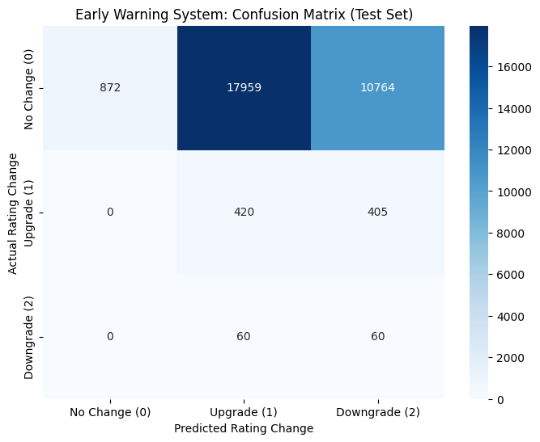

# Credit Risk Early Warning System (deep learning part)

A sequence model that tries to predict whether a country's S&P sovereign credit rating will be
**upgraded, downgraded or left unchanged in the next 30 to 90 days**, from daily market data and
monthly macro data. This is the deep learning part of a course project for *Machine Learning in
Practice II* at Corvinus University of Budapest. The project compares this model with simpler
machine learning models; this repository holds the deep learning part.

## Problem

Rating changes are rare events. In the training windows about 96% of the samples are "no
change", so a model that always says "no change" looks accurate and is useless as an early
warning. The interesting question is whether market signals that move every day (CDS spreads,
bond yields, FX volatility) carry enough information to flag a coming rating action early.

## Data

- **High-frequency (daily):** 5-year CDS spread, 10-year government bond yield and FX
  volatility per country, 2010 onwards, exported from Bloomberg.
- **Low-frequency (monthly or step-wise):** CPI inflation, FX reserves and the central bank
  policy rate, forward-filled onto the daily grid.
- **Target:** S&P rating change events, labelled 0 = no change, 1 = upgrade, 2 = downgrade.

The Bloomberg data is licensed and is **not included** in this repository. The notebook shows
the parsing steps for the Bloomberg wide export format, so it runs on any export with the same
layout.

## Method

1. **Alignment and imputation.** Custom parsers turn the Bloomberg wide format into a long
   `Date x Country` table, resample every country to a daily calendar and fill gaps within each
   country only, so no information leaks across countries.
2. **Chronological split.** Training data ends on 2022-10-20 and everything after it is used for
   testing, so the model always predicts the future from the past.
3. **Windowing.** Each sample is a 60-day look-back window of the daily features plus the
   current macro snapshot, labelled with any rating action 30 to 90 days after the window ends.
4. **Late-fusion model (PyTorch).** A 2-layer LSTM encodes the daily sequence, an MLP encodes
   the macro snapshot, and the two embeddings are concatenated before the classification head.
5. **Class imbalance.** Weighted cross-entropy (weights of about 0.35 / 16.7 / 16.0 for
   no change / upgrade / downgrade) and early stopping on validation loss.

## Results

| Class | Precision | Recall | Support |
|---|---:|---:|---:|
| No change | 1.00 | 0.03 | 29,595 |
| Upgrade | 0.02 | 0.51 | 825 |
| Downgrade | 0.01 | 0.50 | 120 |



The weighted model finds about half of the real upgrades and downgrades, but it pays for that
with far too many false alarms: it flags almost every "no change" window as a coming rating
action. As an early warning system it is **not usable in this form**, and I treat it as an
honest negative result.

What I take from it:

- Each country has only a handful of rating actions in the sample period, so the event classes
  are too small for an LSTM to learn a stable pattern; validation loss starts rising after the
  first epoch.
- Class weights fix the "always predict no change" problem only by moving the error to the
  other side. A ranking or anomaly-score formulation (flag the top k riskiest country-days)
  would fit the real use case better than three-way classification.
- A simpler baseline on engineered features (CDS change over 30 and 90 days, yield spread
  versus peers) is the natural next comparison.

## Run it

```sh
python -m venv .venv && source .venv/bin/activate
pip install -r requirements.txt
jupyter lab credit_risk_ews_deep_learning.ipynb
```

Put the Bloomberg export (`bbg_data_raw.xlsx`) next to the notebook. Training uses Apple
`mps` or CUDA when available and falls back to the CPU.

## Stack

Python, pandas, NumPy, PyTorch, scikit-learn, seaborn, matplotlib
